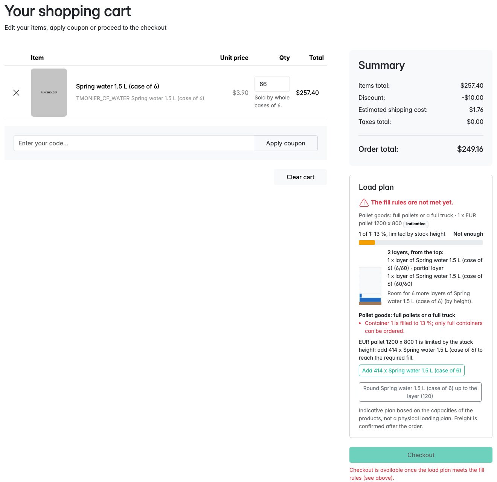
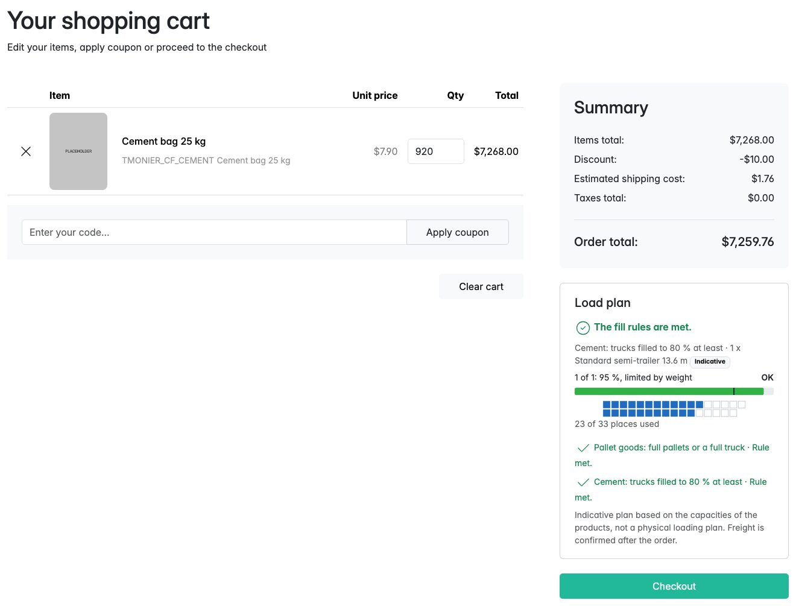
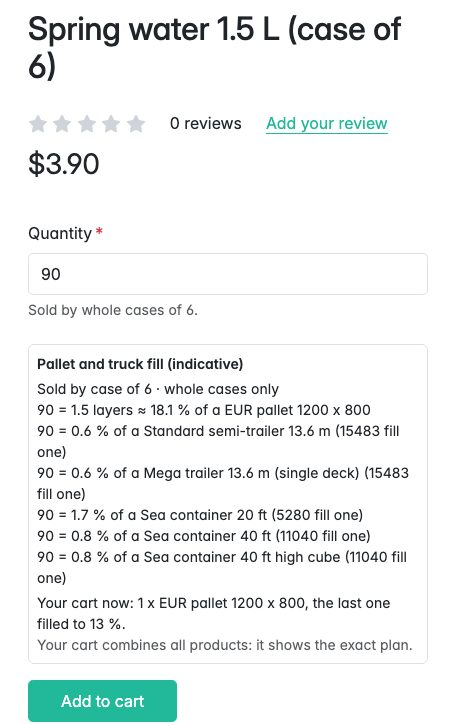
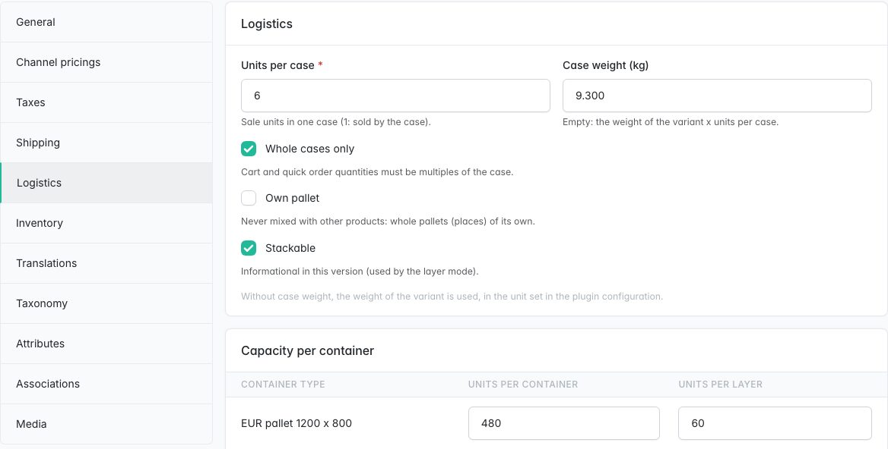
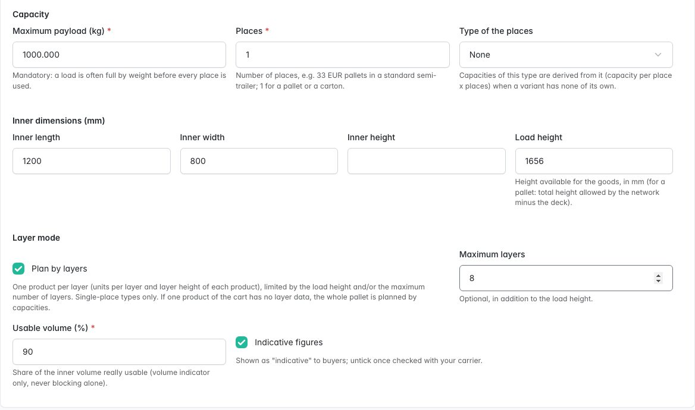
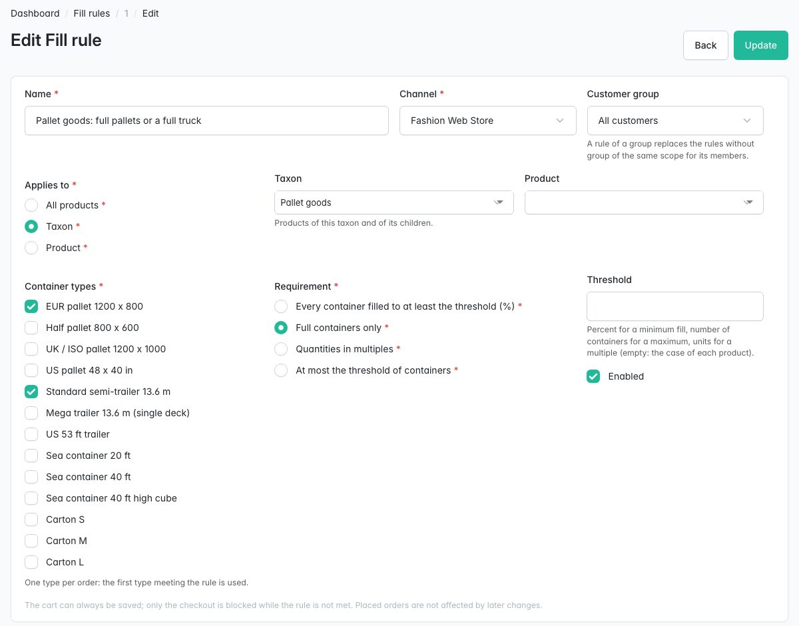
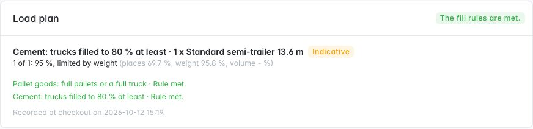

# Pallet & Truckload Builder for Sylius

> English: [README.md](README.md) <!-- vitrine:lang -->

[](https://github.com/thibmonier/sylius-container-fill-plugin/actions/workflows/build.yaml)
[](LICENSE)

**Remplissage de contenants B2B pour Sylius 2 : « palettes complètes uniquement », « remplir le camion à 95 % »,
« vendu par carton de 6 », avec une jauge de remplissage dans le panier et des règles appliquées au tunnel de commande.**

Les grossistes en boissons, matériaux de construction, emballages ou produits alimentaires vendent souvent à la
palette ou au camion complet : une palette mixte doit être complète, un camion doit valoir le déplacement, un
produit s'expédie par cartons entiers. Sylius 2 n'a ni minimum, ni pas, ni multiple de quantité, et aucune notion de
contenant. Le blocage du tunnel de commande sur un poids total existe sur d'autres plateformes, mais personne ne
combine des types de contenants B2B, une contrainte déterminante portant sur les places et la charge utile, la
répartition en plusieurs contenants et une jauge accessible.

Ce plugin ajoute des types de contenants (palettes, camions, conteneurs maritimes, cartons), des données
logistiques par variante, un planificateur de chargement, des règles de remplissage par canal, par portée et par groupe
de clients, une jauge dans le panier qui indique à l'acheteur ce qu'il doit ajouter, et le même blocage dans la
boutique, l'API boutique et l'administration.

## Fonctionnalités

| Besoin | Ce que fait le plugin |
|---|---|
| Décrire les contenants | **Types de contenants** : palette, camion, conteneur maritime, carton ; dimensions intérieures, hauteur de chargement, **charge utile (obligatoire)**, places (33 palettes EUR dans une semi-remorque), type imbriqué. Préréglages indicatifs : palettes EUR / demi / UK / US, semi-remorques standard et méga, 53 pieds US, conteneurs 20 pieds / 40 pieds / 40 pieds HC, cartons. |
| Décrire les produits | **Onglet Logistique** sur le formulaire de variante et sur le formulaire de produit pour les produits simples : unités par carton, poids du carton, palette dédiée, « vendu par cartons entiers », hauteur de couche et gerbable ; unités remplissant chaque type de contenant et unités par couche. Repli sur le poids et les dimensions de Sylius (unités définies dans la configuration). |
| Savoir à quel point la commande est remplie | **Planificateur de chargement** : remplissage = max(places, charge utile), la **contrainte déterminante** est affichée (« limité par le poids »), le volume est un indicateur quand toutes les dimensions sont connues (jamais bloquant) ; les lignes se répartissent en N contenants (first-fit decreasing), les produits sur leur propre palette restent séparés. |
| Règles commerciales | **Règles** par canal, portée (tout, taxon avec ses enfants, produit) et groupe de clients facultatif : **contenants pleins uniquement**, **remplissage minimal en %**, **multiple de N** (ou du carton), **nombre maximal de contenants**, sur une liste de types de contenants autorisés. |
| Composer les palettes par couches | **Mode couches** (1.1, à activer par type de contenant) : une palette est une pile de couches, un produit par couche, limitée par sa hauteur de chargement et/ou un nombre maximal de couches et par sa charge utile ; les produits non gerbables terminent une pile ; vue de côté de chaque palette dans la jauge, « place pour 3 couches de plus », aperçu en couches sur la page produit (« 90 = 1,5 couche ≈ 18 % d'une palette EUR »). |
| Aider l'acheteur | **Jauge dans le panier** (places du camion et pile de palette en SVG côté serveur, indicateur accessible, texte à côté de chaque couleur, mouvement réduit), boutons « ajouter 30 cartons pour compléter la palette 2 » et « arrondir à la couche », bouton de passage de commande désactivé avec la raison. **Aperçu indicatif sur les pages produit** (part d'un contenant occupée par la quantité saisie, remplissage actuel du panier). |
| Appliquer les règles | Entrée du tunnel de commande redirigée vers le panier, **finalisation de la commande refusée dans la boutique et l'API boutique (422)**, garde du workflow en défense en profondeur. Les paniers partiels s'enregistrent toujours ; les commandes passées restent valides quand les règles changent. |
| Exceptions | Les administrateurs ayant un rôle dédié peuvent finaliser une commande qui ne respecte pas les règles : consigné et enregistré sur la commande. |
| Après la commande | **Instantané du plan de chargement** sur la page de commande de l'administration et dans l'API boutique. |
| Fret | Calculateur d'expédition **par contenant** (montant x contenants) et règle d'expédition par **type de contenant**. Montants présentés comme indicatifs. |
| Données en masse | `tmonier:container-fill:import-capacities` / `export-capacities` (CSV, simulation, tout ou rien). |
| Headless | `GET /api/v2/shop/orders/{tokenValue}/load-plan`. |
| Commande rapide | Avec [tmonier/sylius-quick-order-plugin](https://github.com/thibmonier/sylius-quick-order-plugin) : les quantités de la commande rapide suivent les multiples de carton ; la jauge s'affiche sous la matrice de commande (commande rapide 1.1+). |

Également inclus : traductions en anglais, français, allemand, espagnol, italien, néerlandais et polonais ;
Twig Hooks partout ; fixtures de démonstration ; prise en charge de MySQL, MariaDB et PostgreSQL. Aucune entité du
cœur n'est modifiée : le plugin possède ses propres tables.

## Prérequis

| | Version |
|---|---|
| PHP | 8.2+ (Sylius 2.2), 8.3+ (Sylius 2.3) |
| Sylius | 2.2.9+, 2.3 |
| Symfony | 6.4, 7.4 (Sylius 2.2) ; 6.4, 7.4, 8.0 (Sylius 2.3, Symfony 8 nécessite PHP 8.4) |

Sylius 2.2.9 est la version minimale parce que le plugin intervient dans le tunnel de commande : les versions 2.2
antérieures sont touchées par GHSA-2rv4-pjmm-7fxf et GHSA-vv4h-q2x8-74g4.

## Installation

1. Installez le paquet :

    ```bash
    composer require tmonier/sylius-container-fill-plugin
    ```

2. Enregistrez le bundle dans `config/bundles.php` (Symfony Flex le fait automatiquement dès qu'une recette existe) :

    ```php
    Tmonier\SyliusContainerFillPlugin\TmonierSyliusContainerFillPlugin::class => ['all' => true],
    ```

3. Importez la configuration dans `config/packages/tmonier_sylius_container_fill.yaml` :

    ```yaml
    imports:
        - { resource: "@TmonierSyliusContainerFillPlugin/config/config.yaml" }
    ```

4. Importez les routes d'administration dans `config/routes/tmonier_sylius_container_fill.yaml` :

    ```yaml
    tmonier_sylius_container_fill:
        resource: "@TmonierSyliusContainerFillPlugin/config/routes.yaml"
    ```

    L'opération de l'API boutique est enregistrée automatiquement auprès de l'API Sylius (`/api/v2`).

5. Exécutez les migrations (tables du plugin uniquement) :

    ```bash
    bin/console doctrine:migrations:migrate
    ```

6. Chargez les préréglages de types de contenants (facultatif, idempotent), puis vérifiez-les dans l'administration :

    ```yaml
    # config/packages/tmonier_sylius_container_fill.yaml
    sylius_fixtures:
        suites:
            container_types:
                fixtures:
                    tmonier_container_fill_container_types: ~
    ```

    ```bash
    bin/console sylius:fixtures:load container_types
    ```

    `tmonier_container_fill_demo` ajoute des produits de démonstration, une règle et l'acheteur vérifié
    `pallet@example.com` / `sylius` : réservé aux boutiques de démonstration.

## Configuration

```yaml
# config/packages/tmonier_sylius_container_fill.yaml
tmonier_sylius_container_fill:
    units:
        length: cm          # unit of the Sylius variant width, height, depth: mm, cm, m, in
        weight: kg          # unit of the Sylius variant weight: g, kg, lb
    override_role: ROLE_TMONIER_CONTAINER_FILL_OVERRIDE   # null disables overrides
    workflow_guard: true    # also guard the "complete" transition of sylius_order_checkout
    cart_gauge: true        # gauge in the cart, checkout button disabled with the reason
    product_preview: true   # indicative preview on product pages
```

Sylius stocke des nombres bruts pour le poids et les dimensions des variantes : définissez les unités que
votre catalogue utilise. Le plugin stocke ses propres données en millimètres et en grammes ; les formulaires
d'administration prennent des kilogrammes.

**Dérogations.** Personne n'a le rôle de dérogation par défaut. Attribuez-le aux administrateurs autorisés à
finaliser une commande qui ne respecte pas les règles (création de commande dans l'administration, API d'administration) :

```yaml
# config/packages/security.yaml
security:
    role_hierarchy:
        ROLE_ADMINISTRATION_ACCESS: [ROLE_TMONIER_CONTAINER_FILL_OVERRIDE]
```

Chaque dérogation est consignée dans le canal Monolog `tmonier_container_fill` et affichée sur le plan de
chargement de la commande.

### Types de contenants

| Champ | Remarques |
|---|---|
| Nature | `pallet`, `truck`, `sea_container`, `carton` |
| Charge utile maximale | **obligatoire**, en kg : le plafond de charge utile s'applique à chaque contenant |
| Places | 1 pour une palette ou un carton ; 33 pour une semi-remorque standard (palettes EUR) |
| Type des places | le type à une place qui remplit les places : un camion de 33 places de palettes EUR déduit la capacité d'un produit de sa capacité en palettes EUR |
| Dimensions intérieures, hauteur de chargement, volume utile | facultatifs ; quand le contenant et chaque produit ont des dimensions, le volume est affiché comme indicateur (« peut dépasser le volume ») : il ne répartit ni ne bloque jamais, ce sont les capacités que vous saisissez qui décident |
| Indicatif | affiché comme « indicatif » aux acheteurs ; décochez-le une fois vérifié avec votre transporteur |

Les préréglages sont des valeurs indicatives issues de sources publiques (voir `SPEC.md`) : vérifiez-les auprès de vos
transporteurs et de vos réseaux de palettes (hauteurs de chargement de 1,8 à 2,2 m, charges utiles de 1000 à 1500 kg par
palette EUR).

### Mode couches (1.1)

Cochez **Planifier par couches** sur un type de contenant à une place (une palette, un carton) qui a une hauteur de
chargement (ou une hauteur intérieure) et/ou un **nombre maximum de couches**. Donnez à chaque produit une **hauteur
de couche** (onglet Logistique) et ses **unités par couche** pour ce type (ligne de capacité). Alors :

- une palette est une pile de couches, un produit par couche, les couches lourdes en bas ; une couche partielle
  prend la hauteur d'une couche pleine mais compte pour sa part dans le remplissage, et une palette comportant une
  couche partielle qui peut être complétée n'est pas « pleine » (les palettes pleines sont faites de couches pleines) ;
- une palette est limitée par sa hauteur de chargement, son nombre maximum de couches et sa charge utile
  (celle qui limite est indiquée : « limité par la hauteur de pile ») ;
- un produit non gerbable ne supporte rien : au plus une de ses couches par palette, au sommet ;
- la jauge dessine une vue de côté de chaque palette avec ses couches, indique combien de couches peuvent encore
  tenir, et « arrondir à la couche » complète les couches partielles ;
- la page produit s'exprime en couches : « 90 = 1,5 couche ≈ 18 % d'une palette EUR ».

Sans données de couche pour chaque produit d'un plan, ou sur un type sans mode couches, le plan utilise
les capacités, comme en 1.0. Passer de la 1.0 nécessite la migration (colonnes nullables, mode couches
désactivé) : rien ne change tant que vous ne l'activez pas.

### Données logistiques (onglet Logistique du formulaire de variante, ou du formulaire de produit pour les produits simples)

| Champ | Remarques |
|---|---|
| Unités par carton, poids du carton | le poids du carton l'emporte sur le poids Sylius |
| Vendu par cartons entiers | le champ de quantité démarre à un carton et avance par carton ; une quantité qui n'est pas un multiple du carton est refusée à l'ajout au panier (boutique et API boutique), à la modification dans le panier (boutique et API), et le tunnel de commande reste bloqué |
| Palette dédiée | jamais mélangé avec d'autres produits dans un contenant |
| Hauteur de couche (mm), gerbable | mode couches : hauteur d'une couche du produit ; un produit non gerbable ne supporte rien (au plus une de ses couches par palette, au sommet) |
| Capacité par type de contenant | unités remplissant un contenant (mode capacité, camions), unités par couche (mode couches, « arrondir à la couche ») |

Un produit dans la portée d'une règle, avec un poids mais sans capacité pour le type de contenant, rend le plan
**incomplet** : la règle n'est pas respectée et la jauge nomme le produit. Un produit **sans poids
exploitable** (vide, nul ou négatif ; un poids ou une dimension corrompu et non numérique est aussi
consigné comme avertissement nommant la variante) est ignoré par les règles : il ne remplit aucun contenant et ne
bloque pas le panier, de sorte qu'une règle « tous les produits » ne bloque pas les paniers mixtes. Donnez un poids au produit
pour qu'il compte.

### Règles

| Champ | Valeurs |
|---|---|
| Canal | obligatoire |
| Groupe de clients | vide = tout le monde ; la règle d'un groupe remplace la règle générale de même portée pour ce groupe |
| Portée | `all`, `taxon` (avec ses enfants), `product` |
| Types de contenants | types autorisés, essayés dans l'ordre : le premier qui respecte la règle est retenu |
| Mode | `full_only` ; `min_fill_percent` (seuil 1-100) ; `multiple_of` (seuil, ou le carton de chaque ligne si vide) ; `max_containers` (seuil) |

Les contenants surchargés et les plans incomplets échouent à tous les modes. Une règle activée dont les types de
contenants sont tous désactivés bloque le passage de commande de ses produits (signalé dans la grille des règles) :
désactivez la règle plutôt que ses types. Les règles s'appliquent aux lignes de leur
portée ; les paniers sans ligne dans la portée d'une règle n'affichent aucune jauge. Quand plusieurs règles correspondent à une
ligne, **toutes doivent être respectées** (une règle globale « au plus 1 camion » compte aussi les produits d'une
règle de taxon). Le plan de chargement affiché dans la jauge, sur la commande et dans l'API, et compté par
l'expédition par contenant, planifie chaque ligne une seule fois, avec sa règle la plus spécifique : produit, puis
taxon (le plus profond d'abord), puis tous les produits ; à portée égale, la règle du groupe de clients, puis la plus
ancienne. Les lignes de règles différentes sont planifiées dans des contenants séparés.

### Expédition

- Calculateur **Par contenant du plan de chargement** : montant par canal x nombre de contenants des règles
  applicables (un seul quand aucune règle ne s'applique).
- Règle **Type de contenant** : le mode d'expédition est disponible quand le plan de chargement utilise l'un des
  types sélectionnés.

Une seule expédition Sylius par commande. Les montants sont présentés comme indicatifs et le plan indique « Le fret
est confirmé après la commande » : quand votre prix par contenant vous engage, confirmez le fret
après la commande ou établissez un devis (par exemple avec
[tmonier/sylius-quote-request-plugin](https://github.com/thibmonier/sylius-quote-request-plugin)).

### Import et export CSV

```bash
bin/console tmonier:container-fill:export-capacities > capacities.csv
bin/console tmonier:container-fill:import-capacities capacities.csv --dry-run
bin/console tmonier:container-fill:import-capacities capacities.csv
```

Colonnes : `variant_code;container_type;capacity;units_per_layer;units_per_case;case_weight_kg;layer_height_mm`
(`layer_height_mm` depuis la 1.1, facultative : les fichiers 1.0 s'importent sans changement)
(`;` ou `,`, UTF-8 avec ou sans BOM). Les trois premières sont obligatoires ; une `capacity` vide
supprime la capacité ; les colonnes facultatives vides conservent les valeurs enregistrées. Chaque ligne est d'abord
vérifiée : **une seule ligne rejetée et rien n'est écrit** (erreurs par numéro de ligne).

### API boutique

`GET /api/v2/shop/orders/{tokenValue}/load-plan` renvoie le plan d'un panier (calculé à l'instant,
`source: cart`) ou le plan enregistré lors de la passation de la commande (`source: snapshot`) :
indicateur de satisfaction, `plan` (le plan de chargement : par règle de planification, le type de contenant et les contenants,
chaque ligne comptée une fois) et `containerCount`, `rules` (chaque règle applicable vérifiée sur
toute sa portée : type de contenant, contenants avec % de remplissage, rapports de places, de poids et de volume, contrainte
déterminante, unités par produit, violations et suggestion), violations de ligne (« vendu par cartons
entiers »). La commande d'un client enregistré n'est visible que par ce client.
`PATCH /api/v2/shop/orders/{tokenValue}/complete` répond 422 tant que les règles ne sont pas respectées.

### Twig hooks

| Hook | Entrée |
|---|---|
| `sylius_shop.cart.index.content.form.sections.general#right` | `tmonier_container_fill_gauge` (priorité 50) et une surcharge de `checkout` |
| `sylius_shop.product.show.content.info.summary.add_to_cart` | `tmonier_container_fill_preview` |
| `tmonier_quick_order.shop.product.matrix` | `tmonier_container_fill_gauge` (commande rapide 1.1+) |
| `sylius_admin.product_variant.{create,update}.content.form.*` | Onglet Logistique |
| `sylius_admin.product.{create,update}.content.form.*` | Onglet Logistique des produits simples |
| `sylius_admin.order.show.content.sections#left` | carte du plan de chargement |

La jauge est le composant Live `tmonier_container_fill:gauge` : il écoute
`sylius:shop:cart_changed` ; ses actions l'émettent (sur la page du panier, elles rechargent la page).

## Captures d'écran















## Limitations connues

- Une règle commerciale de remplissage, **pas un plan de chargement physique** : pas de bin packing 3D, de rotation,
  d'ordre d'empilement, de charges par essieu, d'arrimage ni d'ADR (responsabilité du transporteur).
- Un seul type de contenant par commande (par règle), une seule expédition Sylius ; pas de double pont dans les
  méga-remorques ; pas de mètres de plancher (LDM).
- Mode couches : un produit par couche (pas de couches mixtes), types de contenants à une place (palettes,
  cartons) ; les camions comptent les places de palettes par capacité. `stackable` n'est utilisé qu'en mode couches.
- L'aperçu de la page produit est indicatif : le panier fait foi pour les paniers mixtes.
- Des règles par groupe de clients, pas par organisation.

## Développement

Voir `CLAUDE.md` pour l'environnement local et les commandes, `SPEC.md` pour la conception et les décisions.

<!-- vitrine:demo-b2b:start -->
## Démo B2B

Ce plugin est utilisé dans la [démo B2B Sylius](https://github.com/thibmonier/sylius-b2b-demo) : une boutique Sylius 2.3 avec des données d'exemple fictives, où les plugins B2B fonctionnent ensemble. Le code source, l'installation et les fixtures de la démo sont dans ce dépôt.

- Démo en ligne : [sylius-b2b.thibaut-monier.fr](https://sylius-b2b.thibaut-monier.fr)
- Auteur : [Thibaut Monier](https://www.linkedin.com/in/thibautmonier/)

La démo est un exemple, pas une configuration de production.
<!-- vitrine:demo-b2b:end -->

## Licence

MIT, voir [LICENSE](LICENSE).
